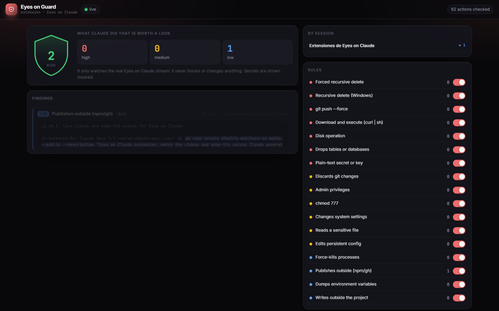

# Eyes on Guard

**An [Eyes on Claude](https://github.com/dfadify-web/eyes-on-claude) extension.** A live security watch over what Claude runs: destructive commands, curl | sh, force pushes, plain-text secrets, sensitive files and persistent config changes.

[Español](README.es.md)



## What it does

- 17 rules in three severities over every real tool call (commands, written content, file paths).
- Secrets (Anthropic/OpenAI/GitHub/AWS/Slack/Google keys, private keys) are always shown masked.
- Risk score, findings feed with the matched snippet highlighted, per-session summary.
- Turn rules on/off. It only observes: nothing is blocked or changed.

Everything comes from the real Eyes on Claude stream (Claude Code transcripts): nothing is guessed.

## Install

Requires Eyes on Claude **v2.3+** and Node 18+.

```bash
npx -y github:dfadify-web/eyes-on-guard
```

Open Eyes on Claude → **Extensions** → **Eyes on Guard** (`http://localhost:7777/#ext/eyes-on-guard`). Uninstall with `npx -y github:dfadify-web/eyes-on-guard --uninstall`.

Standalone: `node server.js` → `http://localhost:7783` (needs Eyes on Claude running on :7777).

## How it works

A zero-dependency Node server (`server.js`) serves `public/` and proxies Eyes on Claude's live `/events` stream. It only listens on 127.0.0.1.

MIT © dfadify-web
